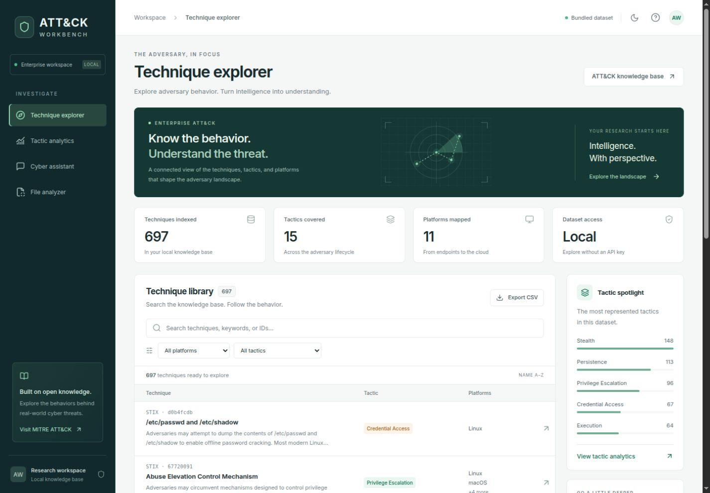
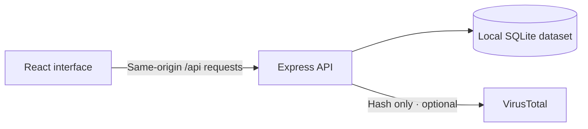
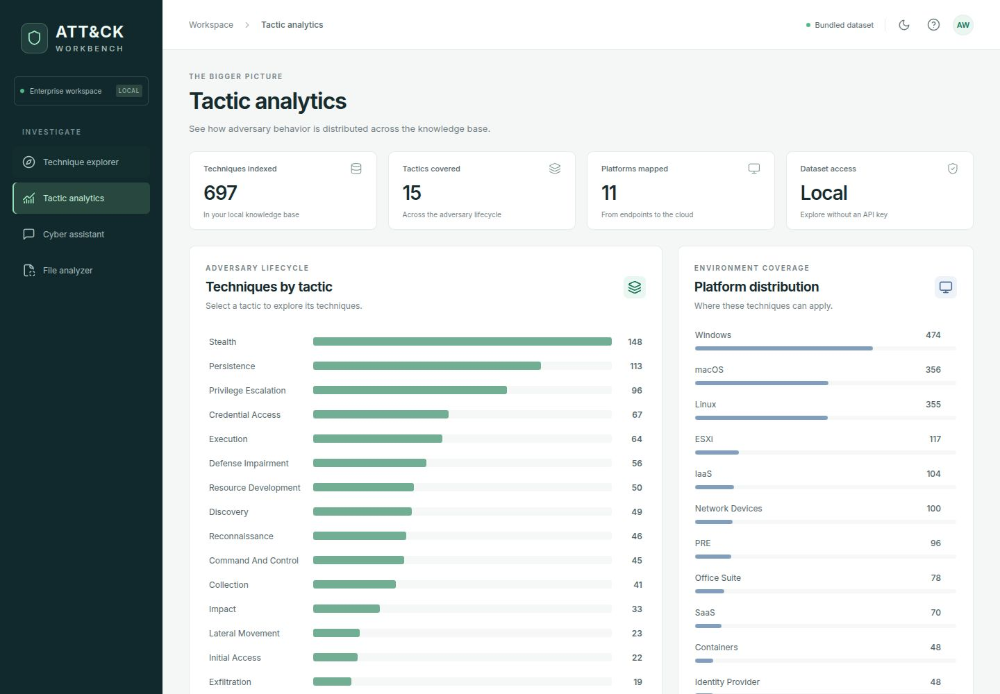
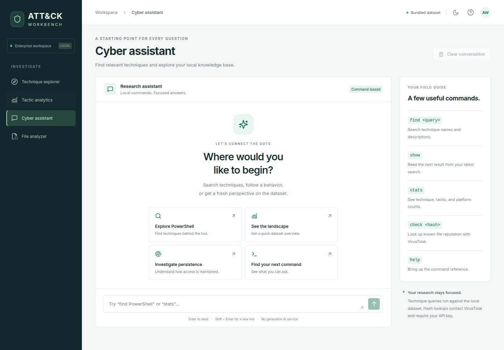
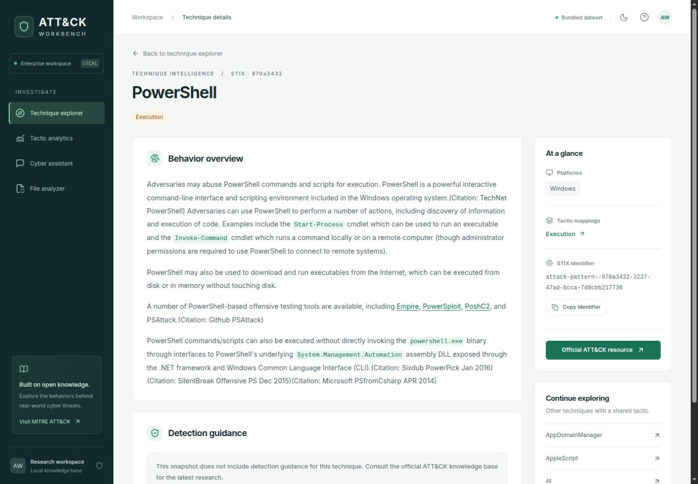
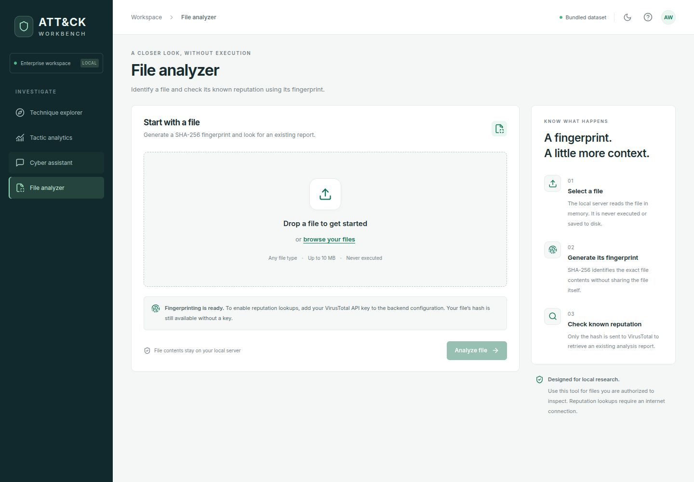
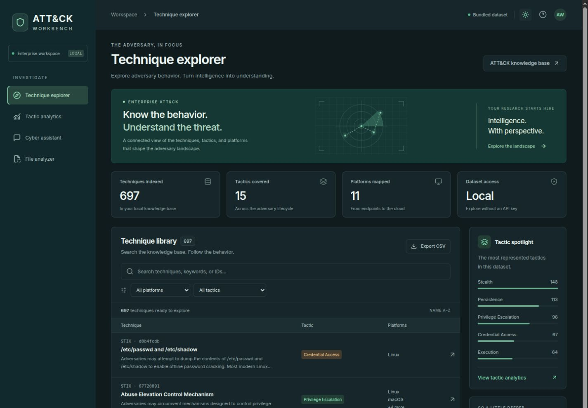
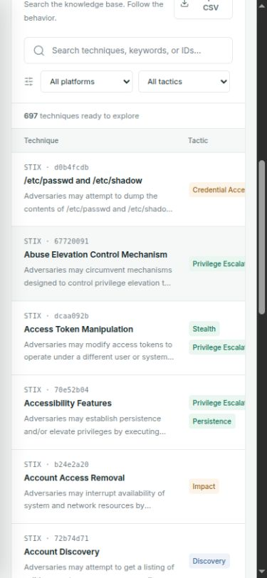

<div align="center">

# ATT&CK Workbench

**Explore adversary behavior. Turn intelligence into understanding.**

A focused, local threat intelligence workspace built with React, Express, and SQLite.

[Quick start](#quick-start) · [Features](#features) · [Architecture](#architecture) · [GitHub publishing guide](docs/GITHUB_GUIDE.md)

</div>



## Why this project

ATT&CK Workbench brings technique research, tactic analytics, a command assistant, and file hash reputation into one consistent interface. The supplied database makes it possible to explore the application immediately, without signing up for a service or downloading data first.

This is an independent educational and research project. It is not an official MITRE product.

## Authorship and AI assistance

All logic and architecture of the original application was written by me. AI assistance was used for the visual redesign and for implementation refinements to the interface.

## Features

| Workspace              | What you can do                                                                                                                                                    |
| ---------------------- | ------------------------------------------------------------------------------------------------------------------------------------------------------------------ |
| **Technique explorer** | Search names, descriptions, STIX identifiers, and available ATT&CK IDs. Combine platform and tactic filters, paginate results, and export filtered records as CSV. |
| **Technique details**  | Read formatted behavior descriptions, inspect platforms and tactic mappings, copy identifiers, and follow related techniques.                                      |
| **Tactic analytics**   | Explore real tactic and platform distributions. Select a tactic to preview its techniques.                                                                         |
| **Cyber assistant**    | Use local commands such as `find PowerShell`, `show`, `stats`, and `help`. Results link to technique pages. No generative AI service is used.                      |
| **File analyzer**      | Generate a SHA-256 fingerprint and retrieve an existing VirusTotal report when configured. Files are never executed.                                               |
| **Responsive design**  | Use the workspace on desktop or mobile, with keyboard navigation and a saved light/dark preference.                                                                |

The supplied snapshot contains **697 techniques, 15 tactics, and 11 platforms**. These are counts from the provided database, not a claim about the latest ATT&CK release. A technique can map to more than one tactic or platform.

## Quick start

Install **Node.js 22.12 or newer in the Node 22 release line**, or Node 24+, with npm. Node 22 is the version specified in `.nvmrc`. [Vite's runtime requirements](https://vite.dev/guide/) explain the build tool's minimum versions.

1. Extract or clone this repository.
2. Open a terminal inside the `mitre-attack-workbench` folder, where the root `package.json` is located.
3. Run:

```bash
npm ci
npm run dev
```

Open **[http://127.0.0.1:5173](http://127.0.0.1:5173)**. The API runs on port **3001**. Keep the terminal open; press **Ctrl+C** to stop both processes. Frontend edits reload automatically; restart the command after backend edits.

The included SQLite database is ready to use. No seed command or API key is required for the explorer, analytics, or technique assistant.

### Optional: enable VirusTotal reputation lookup

Copy `backend/.env.example` to `backend/.env`.

macOS / Linux / Git Bash:

```bash
cp backend/.env.example backend/.env
```

Windows PowerShell:

```powershell
Copy-Item backend/.env.example backend/.env
```

Add your own key:

```dotenv
VT_API_KEY=your_virustotal_api_key
PORT=3001
HOST=127.0.0.1
```

Restart `npm run dev` after changing this file. The server loads configuration from `backend/.env` regardless of the terminal's working directory. `.env` is ignored by Git; `.env.example` is safe to commit.

Only a file's SHA-256 hash is sent to VirusTotal. The local server reads the file in memory, limits uploads to 10 MB, and does not save or execute it. Without a key, fingerprinting still works and the interface reports that reputation is unavailable. A missing report, service error, or zero detections is never proof that a file is safe.

## Commands

Run these from the repository root:

| Command         | Purpose                                                                                                                   |
| --------------- | ------------------------------------------------------------------------------------------------------------------------- |
| `npm ci`        | Install exact versions from the committed lockfile.                                                                       |
| `npm run dev`   | Start the API and Vite development server together.                                                                       |
| `npm test`      | Run 10 API and reputation regression tests using an isolated in-memory database.                                          |
| `npm run build` | Build the React frontend into `frontend/dist`.                                                                            |
| `npm start`     | Serve the API and built frontend together on port 3001. Run the build first.                                              |
| `npm run seed`  | Replace the local technique dataset with active techniques from the official MITRE STIX bundle. Requires internet access. |

### Run the production build locally

Stop the development server first, then run:

```bash
npm run build
npm start
```

Open **[http://127.0.0.1:3001](http://127.0.0.1:3001)**. Express serves both the app and API, including direct links to technique pages. This command is also useful for reviewing the optimized build before a demo.

### Refresh the dataset

The original 697-record snapshot is included in `backend/mitre.db`. Its exact upstream release was not recorded in the supplied archive. It stores STIX identifiers; the UI does not invent missing ATT&CK technique IDs.

Back up `backend/mitre.db` before running `npm run seed`. The refresh downloads the official [MITRE enterprise STIX bundle](https://github.com/mitre/cti/tree/master/enterprise-attack), removes revoked/deprecated records, and replaces the dataset in one transaction. It also stores official technique IDs and source URLs when available. Reload the browser afterward. Counts may change after a refresh. The bundled database was preserved rather than refreshed during the redesign.

## Architecture



During development, Vite proxies `/api` to port 3001. In the production build, Express serves the frontend and API from one origin. The client contains no hard-coded API hostname and no secret key.

```text
mitre-attack-workbench/
├── backend/
│   ├── routes/          # Assistant and file analysis endpoints
│   ├── services/        # Search and reputation lookup
│   ├── test/            # API and reputation regression tests
│   ├── .env.example     # Optional local configuration
│   ├── mitre.db         # Bundled public technique snapshot
│   ├── seed.js          # Optional dataset refresh
│   └── server.js        # API and production frontend server
├── frontend/
│   ├── public/          # App icon
│   ├── src/pages/       # Five workspace screens
│   ├── src/data.jsx     # Dataset loading, text helpers, CSV export
│   ├── src/components.jsx
│   └── src/styles.css   # Responsive design and theme tokens
├── scripts/dev.mjs      # Cross-platform development launcher
├── docs/                # Screenshots and GitHub guide
├── .github/             # CI, Dependabot, and contribution templates
└── package-lock.json    # Reproducible workspace install
```

### API overview

| Method | Endpoint                      | Purpose                                                             |
| ------ | ----------------------------- | ------------------------------------------------------------------- |
| GET    | `/api/health`                 | Service state and whether optional reputation lookup is configured. |
| GET    | `/api/attacks?search=keyword` | All techniques or a search result.                                  |
| GET    | `/api/attacks/:id`            | One record by STIX identifier.                                      |
| GET    | `/api/stats`                  | Technique total and individual tactic/platform mappings.            |
| POST   | `/api/chat`                   | A command and optional conversation context.                        |
| POST   | `/api/sandbox/upload`         | Multipart `file`, SHA-256 fingerprint, and optional reputation.     |

## Screenshots

<details>
<summary>Tactic analytics</summary>



</details>

<details>
<summary>Research assistant</summary>



</details>

<details>
<summary>Technique detail</summary>



</details>

<details>
<summary>File analyzer</summary>



</details>

<details>
<summary>Dark theme</summary>



</details>

<details>
<summary>Mobile layout</summary>



</details>

## Verification

The redesign was verified with a production build, 10 automated backend tests, and browser checks. See [verification notes](docs/VERIFICATION.md) for the tested flows and limits. The included GitHub Actions workflow runs tests and builds on Linux and Windows with Node 22 after you push the repository; its hosted runs have not been executed yet.

## Troubleshooting

- **`npm` is not recognized:** install Node.js, restart your terminal, then check `node --version` and `npm --version`.
- **Native SQLite installation fails:** use Node 22 LTS and run `npm ci` again. Do not copy another machine's `node_modules`. If your platform has no prebuilt SQLite binary, a C/C++ build toolchain may be required.
- **Port already in use:** stop the other app using 3001 or 5173. The Vite proxy assumes the default API port. If you change the backend port, update `frontend/vite.config.js` to match.
- **Connection interrupted:** keep `npm run dev` running and check the terminal for backend errors.
- **VirusTotal report unavailable:** verify `VT_API_KEY`, restart the server, and check the returned status. Unknown hashes and rate limits are shown explicitly.
- **`npm start` does not show the app:** run `npm run build` first.

## Project scope

This app currently targets local research. It has no user authentication, authorization, or durable conversation storage. Public hosting requires deployment-specific access controls, HTTPS, request limiting, and persistent SQLite storage. GitHub Pages alone cannot run this Express/SQLite application. [GitHub Pages documentation](https://docs.github.com/en/pages/getting-started-with-github-pages/what-is-github-pages) describes its static hosting model.

## Attribution and licensing

MITRE ATT&CK® data remains subject to MITRE's terms. See [third-party notices](THIRD_PARTY_NOTICES.md) and the included [MITRE license](docs/MITRE-LICENSE.txt). This project is not affiliated with or endorsed by MITRE.

A repository-wide license for the application code has not been selected. The repository owner should choose the intended code license before describing this project as open source. Dependency licenses remain with their respective owners.
